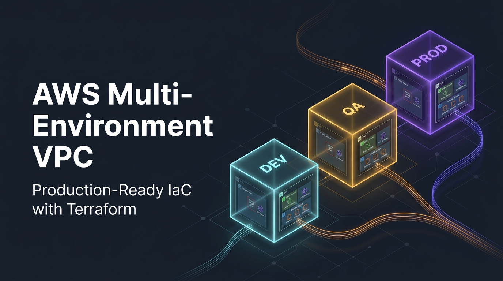
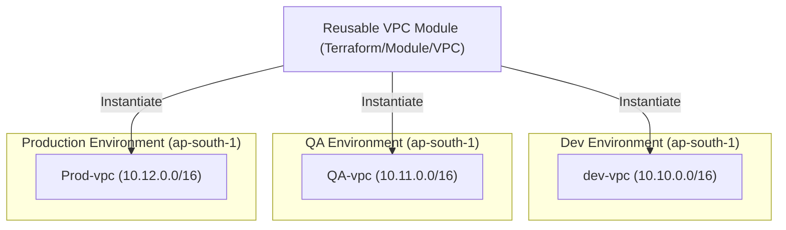

<p align="center">
  
</p>

# 🌐 AWS Multi-Environment VPC Architecture with Terraform

<p align="left">
  
  
  
  
</p>

A modular, production-ready Infrastructure-as-Code (IaC) repository that provisions isolated **Virtual Private Clouds (VPCs)** across multiple environments (**Dev**, **QA**, and **Production**) on AWS using reusable **Terraform modules**.

---

## 📌 Architecture Highlights

- **Reusable VPC Module:** Implements the DRY (*Don't Repeat Yourself*) principle by defining VPC infrastructure once in `Terraform/Module/VPC` and reusing it across all stages.
- **Environment Isolation:** Dev, QA, and Production are completely decoupled in separate root modules with independent state management.
- **Non-Overlapping CIDRs:** Each environment is assigned a dedicated `/16` CIDR block, preventing IP address conflicts and enabling future VPC Peering or Transit Gateway connectivity.
- **DNS Ready:** `enable_dns_hostnames` and `enable_dns_support` are enabled by default for seamless internal service discovery.
- **Standardized Tagging:** Automatically enforces environment and naming conventions for unified billing and resource tracking.

---

## 🏛️ System Architecture Flow



---

## 📊 Environment Breakdown

| Environment | VPC Name | CIDR Block | AWS Region | Directory Path |
| :--- | :--- | :--- | :--- | :--- |
| 🟢 **Development** | `dev-vpc` | `10.10.0.0/16` | `ap-south-1` | `Terraform/Environments/Dev` |
| 🟡 **QA / Testing** | `QA-vpc` | `10.11.0.0/16` | `ap-south-1` | `Terraform/Environments/QA` |
| 🔴 **Production** | `Prod-vpc` | `10.12.0.0/16` | `ap-south-1` | `Terraform/Environments/Production` |

---

## 📂 Project Structure

```text
terraform-vpc-multi-env/
├── assets/
│   └── banner.png                  # Repository header banner
├── .gitignore                      # Prevents committing state files and binaries
├── README.md                       # Comprehensive project documentation
└── Terraform/
    ├── Environments/
    │   ├── Dev/
    │   │   ├── main.tf             # Dev root module & AWS provider
    │   │   ├── variable.tf         # Dev input variable definitions
    │   │   ├── terraform.tfvars    # Dev CIDR block & environment values
    │   │   └── output.tf           # Dev VPC ID & CIDR outputs
    │   ├── QA/
    │   │   ├── main.tf             # QA root module & AWS provider
    │   │   ├── variable.tf         # QA input variable definitions
    │   │   ├── terraform.tfvars    # QA CIDR block & environment values
    │   │   └── output.tf           # QA VPC ID & CIDR outputs
    │   └── Production/
    │       ├── main.tf             # Production root module & AWS provider
    │       ├── variable.tf         # Production input variable definitions
    │       ├── terraform.tfvars    # Production CIDR block & environment values
    │       └── output.tf           # Production VPC ID & CIDR outputs
    └── Module/
        └── VPC/
            ├── main.tf             # Reusable aws_vpc resource definition
            ├── variable.tf         # Module input parameters
            └── output.tf           # Exported module attributes (vpc_id, vpc_cidr_block)
```

---

## ⚙️ Prerequisites

Before you begin, ensure you have:

1. **[Terraform CLI](https://developer.hashicorp.com/terraform/downloads)** (`>= 1.5.0`)
2. **[AWS CLI](https://aws.amazon.com/cli/)** installed and authenticated:
   ```bash
   aws configure
   ```

---

## 🚀 Step-by-Step Deployment Guide

You can deploy any environment independently without affecting the others.

### 1. Deploy Development Environment

```bash
# Navigate to Dev directory
cd Terraform/Environments/Dev

# Initialize Terraform (downloads AWS provider and links module)
terraform init

# Review planned infrastructure
terraform plan

# Apply changes to AWS
terraform apply
```

### 2. Deploy QA Environment

```bash
# Navigate to QA directory
cd ../QA

# Initialize and apply
terraform init
terraform plan
terraform apply
```

### 3. Deploy Production Environment

```bash
# Navigate to Production directory
cd ../Production

# Initialize and apply
terraform init
terraform plan
terraform apply
```

---

## 📤 Outputs

Each environment exports the following values upon successful deployment:

| Output Name | Description |
| :--- | :--- |
| `vpc_id` | The unique AWS ID assigned to the provisioned VPC (e.g. `vpc-xxxxxxxxxxxxxxxxx`) |
| `vpc_cidr_block` | The assigned CIDR IPv4 range for that environment |

---

## 🧹 Teardown / Clean Up

To delete the VPC infrastructure for an environment when testing is complete:

```bash
# Inside the specific environment directory (e.g. Dev, QA, or Production)
terraform destroy
```

---

## 🔒 Security & Best Practices

> [!TIP]
> **State Isolation:** Each environment maintains its own isolated Terraform state file. A change in Development will never accidentally modify QA or Production state.

> [!IMPORTANT]
> **Remote State Recommendation:** For team collaboration, configure an Amazon S3 backend with DynamoDB state locking in each environment's `main.tf` to store state securely in the cloud.

---

## 📝 License

Distributed under the MIT License. See `LICENSE` for more information (if applicable).
